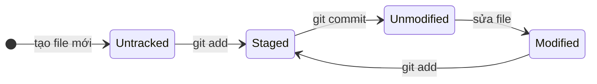

<!--
Bài mẫu áp dụng đủ 6 tiêu chí trong TEACHING.md ở gốc repo. Nội dung ví dụ là `git init`,
`git add`, `git commit`. Khi viết track của bạn, giữ cấu trúc các mục, thay nội dung.
Mỗi mục có một dòng "(Tiêu chí Tx)" để bạn đối chiếu; xóa các dòng đó trong bài thật.
-->

# Bài mẫu: dạy theo chuẩn dễ hiểu

Bài này dùng ví dụ "tạo commit đầu tiên với Git" để cho thấy một bài học đạt chuẩn trông thế nào.

<!--
Tiêu chí T1: hộp "Từ mới trong bài" không viết ở đây. Site tạo nó từ `terms:` ở front matter
và tracks/example-track/glossary.yaml. Trong bài, vẫn giải thích chữ ở lần đầu nó xuất hiện,
và viết nó trong câu văn (không chỉ trong code) để site gạch chân và chú thích được.
-->

Ta sẽ init một repository mới, đưa một file từ trạng thái untracked vào khu stage, rồi chốt nó.

## 1. Vì sao cần học cái này

Bạn sửa bài tập lớn, lỡ xóa mất đoạn code chạy được hôm qua. Nếu có Git, bạn quay lại đúng mốc hôm qua chỉ bằng một lệnh. Mỗi mốc như vậy gọi là một **commit**.

## 2. Bốn trạng thái của một file *(Tiêu chí T3)*

Git chia file trong thư mục của bạn thành 4 trạng thái. Mỗi mũi tên là một lệnh:



| Trạng thái | Nghĩa | Ví dụ |
| --- | --- | --- |
| **Untracked** | file mới, Git chưa biết | vừa tạo `index.html` |
| **Staged** | đã chọn để đưa vào commit tiếp theo | vừa chạy `git add index.html` |
| **Unmodified** | giống hệt bản đã commit | vừa commit xong |
| **Modified** | đã sửa sau lần commit cuối, chưa `add` | sửa một dòng trong `index.html` |

Hai trạng thái hay bị nhầm là **Modified** và **Staged**. Cả hai đều là "đã sửa". Khác nhau ở chỗ Staged là bạn đã *chọn* thay đổi đó cho commit tiếp theo, còn Modified thì chưa.

## 3. Làm thử từng bước *(Tiêu chí T2)*

Chạy từng lệnh, đọc kết quả, rồi mới sang lệnh tiếp theo.

```bash
mkdir hello-git
cd hello-git
git init
```

**Đọc hiểu**

- `mkdir` = *make directory*: tạo thư mục `hello-git`.
- `cd` = *change directory*: đi vào thư mục đó.
- `git init` tạo thư mục ẩn `.git`. Từ lúc này Git theo dõi `hello-git`. Bạn sẽ thấy `Initialized empty Git repository in …/hello-git/.git/`.

```bash
echo "Xin chào" > index.html
git status
```

**Đọc hiểu**

- `echo "Xin chào" > index.html` tạo file `index.html` có một dòng.
- `git status` hiện `Untracked files: index.html`: file mới, Git chưa theo dõi (bảng ở mục 2).

```bash
git add index.html
git commit -m "Thêm trang chủ"
```

**Đọc hiểu**

- `git add` chuyển file sang **Staged**.
- `git commit` lưu mốc. `-m` = *message*, lời nhắn mô tả mốc này. File giờ là **Unmodified**.
- Chạy `git status` lần nữa: `nothing to commit, working tree clean`.

## 4. Ngoài thực tế *(Tiêu chí T4)*

Khi làm nhóm, không ai commit thẳng lên nhánh chính (`main`). Quy trình thường là:

1. tạo nhánh riêng cho việc mình làm;
2. commit trên nhánh đó;
3. mở **Pull Request** (PR, *yêu cầu gộp*) để bạn cùng nhóm xem;
4. CI (*Continuous Integration*, chạy kiểm tra tự động) báo xanh, người review đồng ý;
5. gộp (*merge*) vào `main`.

Vì sao làm vậy: nếu ai cũng sửa thẳng trên `main` thì một lỗi nhỏ của một người làm hỏng code của cả nhóm, và không ai kịp xem trước.

## 5. Khi bị lỗi *(Tiêu chí T5, T6)*

| Lỗi | Vì sao | Cách sửa |
| --- | --- | --- |
| `Author identity unknown` khi commit | chưa khai báo tên và email | làm mục "Chuẩn bị chung" ở trang **Cài đặt** của track |
| `fatal: not a git repository` | đang đứng ngoài thư mục đã `git init` | `cd` vào đúng thư mục |
| Lỗi khác, hoặc chưa hiểu vì sao | | nhắn mentor của track, công khai hay **nhắn riêng** đều được (trang **Cài đặt** → "Hỏi ở đâu") |

## Tóm tắt

- `git init` khởi tạo repo; `git add` đưa thay đổi vào khu chờ; `git commit` chốt một mốc.
- Một file đi qua 4 trạng thái: Untracked → Staged → Unmodified → Modified.
- Làm nhóm thì commit trên nhánh riêng rồi mở Pull Request.
